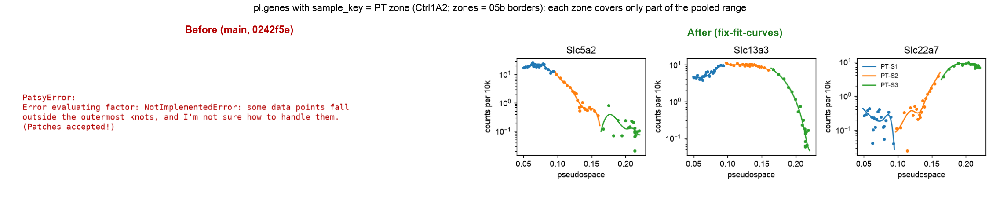
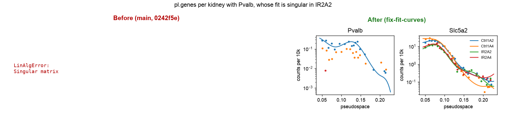
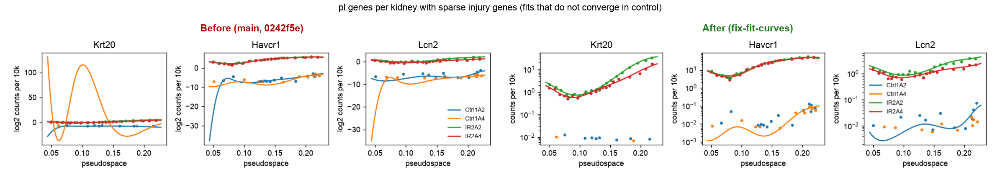
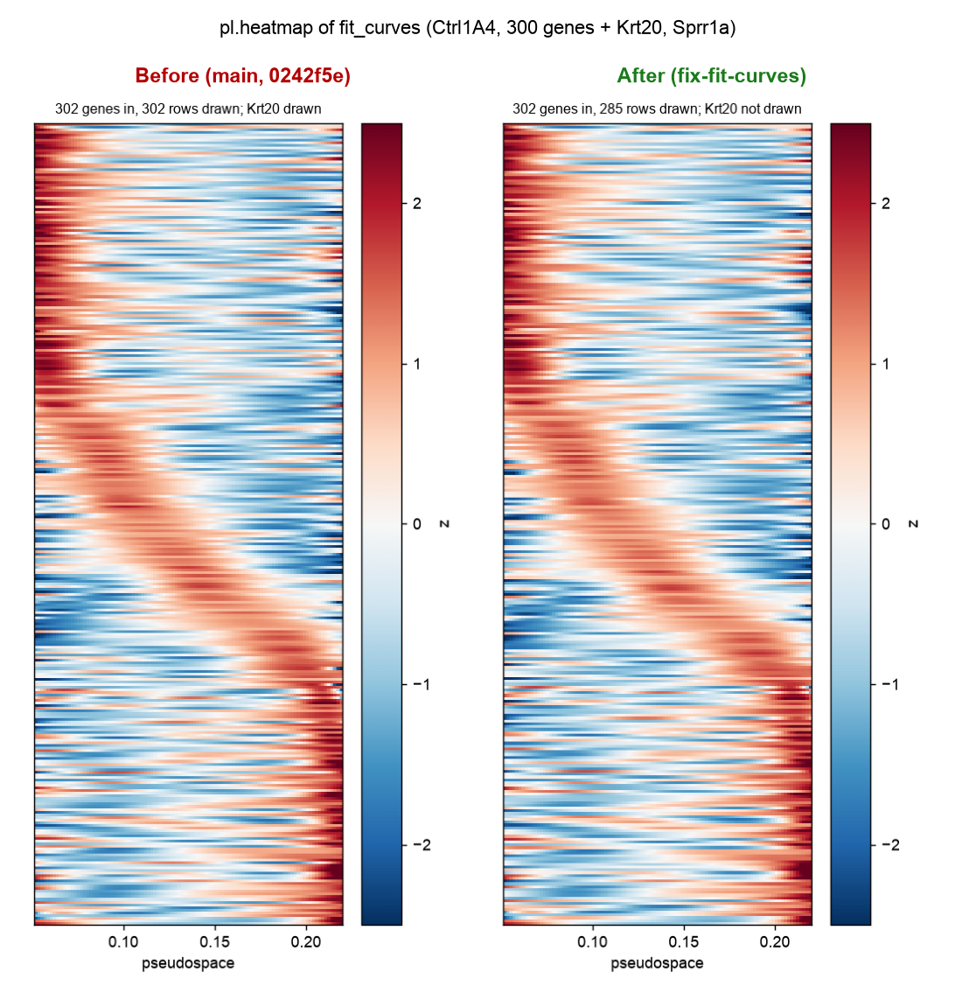

# fix-fit-curves: before / after

Same COAST calls on mouse kidney Visium HD proximal-tubule units (two healthy, two ischemia-reperfusion kidneys), run with
`main` (0242f5e, left) and this branch (right). A call that raised is shown as its error. On the branch, `pl.genes` draws
counts per 10k on a log axis instead of log2 counts per 10k (same curves, readable units, no negative values; bins with no
counts are not drawn).

1. `pl.genes(..., sample_key="zone")`, one group per proximal-tubule zone: each zone covers only part of the pooled 5-95 %
   range, so `fit_curves` was asked to evaluate the spline outside the group's data and patsy raised. Now NaN there.
   
2. `pl.genes(..., sample_key="sample")` with *Pvalb*: its NB fit is singular in one kidney, which stopped the whole call.
   Now that kidney's curve is NaN.
   
3. Sparse injury genes in healthy kidneys: the NB fit did not converge (quasi-separation) and the curve exploded
   (*Krt20* to 2^115). `test_genes` already drops non-converged fits; `fit_curves` now returns NaN for them too.
   Converged curves are unchanged (bit-identical).
   
4. `pl.heatmap` drops genes without a fit and orders by `nanargmax`.
   
